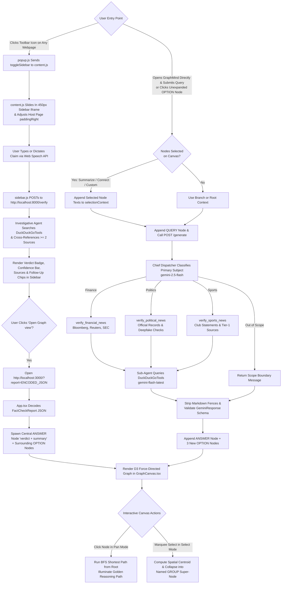

# Orion (Leo Assistant) & GraphMind — End-to-End Multi-Agent Fact-Checking & Knowledge Graph Platform

An end-to-end AI fact-checking and investigative research ecosystem consisting of three tightly integrated layers:
1. **Chrome Manifest V3 Extension (`orion-extension/` — Leo Assistant):** An in-page slide-out sidebar with voice/text input that verifies claims while browsing and renders structured verdict cards.
2. **Hierarchical Multi-Agent Backend (`backend/` — FastAPI + Agno + Gemini):** A dual-endpoint Python API (`POST /verify` and `POST /generate`) combining multi-source investigative auditing with domain-routed specialist agents (Finance, Politics, Sports) backed by live DuckDuckGo web search.
3. **Non-Linear Knowledge Graph Workspace (`frontend/` — GraphMind):** A React + TypeScript + D3 force-directed graph canvas that ingests extension audit reports via URL parameters, traces reasoning provenance via Breadth-First Search (BFS), and supports multi-node context synthesis and subgraph clustering.

---

## Complete System Architecture Diagram

```mermaid
flowchart LR
    subgraph Extension["Chrome Extension MV3 (orion-extension/)"]
        Popup["popup.html / popup.js\n(Toolbar Trigger)"]
        Content["content.js / content.css\n(450px Reflowing Iframe Injector)"]
        Sidebar["sidebar.html / sidebar.js\n(Voice Input, Fact Cards & Graph Handoff)"]
    end

    subgraph Backend["Backend — FastAPI (backend/main.py :8000)"]
        VerEP["POST /verify\n(CheckRequest -> FactCheckReport)"]
        GenEP["POST /generate\n(QueryRequest -> GeminiResponse)"]

        subgraph Supervisors["Supervisor Agents (gemini-2.5-flash)"]
            FactChecker["Investigative Fact-Check Agent\n(Multi-Source Auditor)"]
            Dispatcher["Chief Dispatcher Agent\n(Domain Router + Pydantic Guard)"]
        end

        subgraph Workers["Specialist Agent Tools (gemini-flash-latest)"]
            Fin["verify_financial_news()\nutils/FinancialNewsAgent.py"]
            Pol["verify_political_news()\nutils/PolicitalNewsAgent.py"]
            Spt["verify_sports_news()\nutils/SportNewsAgent.py"]
        end
    end

    DDG["DuckDuckGoTools()\n(Live Web Search)"]

    subgraph Frontend["Frontend — React + TypeScript + Vite (GraphMind :3000)"]
        App["App.tsx\n(?report= Parser, Graph State & Grouping)"]
        Canvas["GraphCanvas.tsx\n(D3 Force Physics, BFS Golden Path & Search)"]
        Input["InputBar.tsx\n(Prompt & Multi-Node Summarize/Connect)"]
        Service["services/geminiService.ts\n(Typed HTTP Adapter)"]
    end

    Popup -->|toggleSidebar| Content
    Content --> Sidebar
    Sidebar -->|1. POST /verify| VerEP
    VerEP --> FactChecker
    FactChecker --> DDG
    VerEP -->|2. FactCheckReport JSON| Sidebar

    Sidebar -.->|3. Open Graph View\n?report=URL_ENCODED_JSON| App

    App <--> Canvas
    Input --> App
    App --> Service
    Service -->|4. POST /generate| GenEP

    GenEP --> Dispatcher
    Dispatcher -->|Finance| Fin
    Dispatcher -->|Politics| Pol
    Dispatcher -->|Sports| Spt
    Fin & Pol & Spt --> DDG
```



---

## End-to-End User & Data Lifecycle Flowchart



---

## Repository Structure

```text
mumbai_hacks/
├── backend/
│   ├── main.py                        # FastAPI server (/generate & /verify) + Agno supervisor agents
│   ├── router_architechture.py         # Standalone CLI multi-agent routing testbed
│   └── utils/
│       ├── __init__.py
│       ├── FinancialNewsAgent.py      # @tool specialist for financial news & fraud detection
│       ├── PolicitalNewsAgent.py      # @tool specialist for political claims & deepfake/context checks
│       └── SportNewsAgent.py          # @tool specialist for sports results & transfer rumors
├── frontend/
│   ├── components/
│   │   ├── GraphCanvas.tsx            # D3 force simulation, BFS Golden Path, marquee select & search
│   │   └── InputBar.tsx               # Auto-resizing prompt bar with multi-node Summarize/Connect pills
│   ├── services/
│   │   └── geminiService.ts           # Typed HTTP client bridging React state to FastAPI (:8000)
│   ├── App.tsx                        # GraphMind state engine, ?report= parser & subgraph grouping
│   ├── constants.ts                   # Application constants
│   ├── types.ts                       # TypeScript definitions (GraphNode, GraphLink, NodeType)
│   ├── index.tsx                      # React DOM entry point
│   ├── index.html                     # HTML entry template
│   ├── package.json                   # Frontend dependencies (React, D3, Lucide, UUID)
│   ├── tsconfig.json                  # TypeScript compiler configuration
│   └── vite.config.ts                 # Vite bundler configuration
└── orion-extension/
    ├── manifest.json                  # Chrome Manifest V3 configuration & permissions
    ├── background.js                  # MV3 background service worker
    ├── content.js                     # Isolated iframe injector & host webpage reflow controller
    ├── content.css                    # Host webpage transition styles
    ├── popup.html                     # Extension toolbar popup UI
    ├── popup.js                       # Active-tab message dispatcher for sidebar toggling
    ├── sidebar.html                   # Fact-checker sidebar layout & verdict card styles
    └── sidebar.js                     # /verify API client, Web Speech API input & GraphMind deep-linker
```

---

## Key Engineering & Algorithmic Highlights

### 1. Non-Intrusive Chrome MV3 Architecture & Stateless Cross-App Bridge (`orion-extension/`)
* **CSS-Isolated Sidebar with Host Page Reflow (`content.js`):** Instead of injecting raw DOM nodes that conflict with host site stylesheets, `content.js` mounts an `<iframe>` pointing to `chrome.runtime.getURL("sidebar.html")` and smoothly adjusts `document.body.style.paddingRight` (`450px`) so articles remain readable beside the assistant.
* **Multimodal Input & Rich Verdict Cards (`sidebar.js`):** Integrates the browser's native Web Speech API (`SpeechRecognition`) for hands-free claim dictation and renders structured `FactCheckReport` cards with dynamic verdict badges, confidence meters, external citations, and interactive follow-up chips.
* **Zero-Database Extension-to-SPA Handoff (`sidebar.js` → `App.tsx`):** Clicking **Open Graph view** encodes the `FactCheckReport` payload directly into the target URL (`http://localhost:3000/?report=...`), allowing the standalone React SPA to hydrate a hub-and-spoke exploration graph immediately without requiring shared authentication or a middle-tier database.

### 2. Hierarchical Supervisor–Worker Multi-Agent Backend (`backend/`)
* **Strict Domain Routing (`main.py`, `router_architechture.py`):** A Chief Dispatcher agent (`gemini-2.5-flash`) classifies queries by primary subject (Finance, Politics, or Sports) and strictly delegates execution to `@tool`-wrapped specialist sub-agents rather than answering from parametric memory.
* **Domain-Isolated Specialists (`backend/utils/`):** Each specialist instantiates its own `gemini-flash-latest` agent with `DuckDuckGoTools()` and domain-specific verification rubrics—checking SEC filings/Bloomberg/Reuters for financial scams, official records/transcripts for political misinformation or deepfakes, and club/Tier-1 confirmations for sports transfer rumors.
* **Schema-Injected JSON Reliability (`backend/main.py`):** Because combining native `output_schema` constraints with external tool calls in Gemini triggers HTTP 400 errors, the backend injects `BaseModel.model_json_schema()` directly into the agent instructions, strips markdown fences via `clean_json_string()`, and validates outputs through Pydantic (`GeminiResponse` and `FactCheckReport`).

### 3. Non-Linear D3 Force Graph & Algorithmic Navigation (`frontend/`)
* **BFS Shortest-Path Provenance (`GraphCanvas.tsx`):** Clicking any node in `pan` mode runs an $O(V + E)$ Breadth-First Search (`getShortestPath`) from the root node to illuminate the exact ancestor chain in a gold gradient.
* **Multi-Node Context Synthesis (`InputBar.tsx` & `App.tsx`):** Selecting multiple nodes via `Shift+Click` or marquee box selection (`select` mode) unlocks one-click **Summarize** and **Connect** actions that inject selected node contents into `selectionContext` for cross-branch synthesis.
* **Lossless Subgraph Clustering (`App.tsx` & `GraphCanvas.tsx`):** Collapses selected subgraphs into named `GROUP` super-nodes positioned at their spatial centroid—partitioning internal vs. external edges and sanitizing D3's mutated object references back into raw string IDs—and expands them back onto the canvas on demand.

---

## Local Setup & Installation

### Prerequisites
* Python 3.11+
* Node.js 18+
* Google Chrome (or any Chromium-based browser)
* Google Gemini API Key (`GOOGLE_API_KEY`)

### 1. Start the FastAPI Backend (`:8000`)
```bash
cd backend
python -m venv .venv
source .venv/bin/activate        # Windows: .venv\Scripts\activate
pip install fastapi uvicorn pydantic agno google-genai duckduckgo-search python-dotenv
echo "GOOGLE_API_KEY=your_gemini_api_key_here" > .env
python main.py                   # Runs on [http://0.0.0.0:8000](http://0.0.0.0:8000)
```

### 2. Start the React + D3 Frontend (`:3000`)
```bash
cd frontend
npm install
npm run dev -- --port 3000
```

### 3. Load the Chrome Extension (`orion-extension/`)
1. Open Chrome and navigate to `chrome://extensions/`.
2. Enable **Developer mode** (top-right toggle).
3. Click **Load unpacked** and select the `orion-extension/` folder.
4. Click the **Leo Assistant** extension icon on any webpage to open the fact-checking sidebar.
